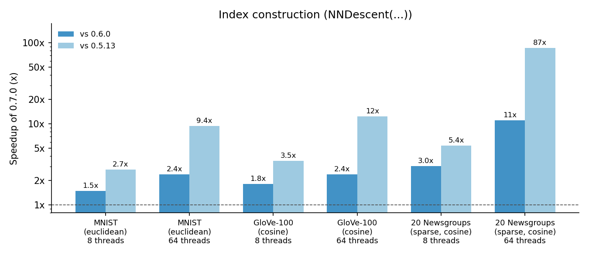
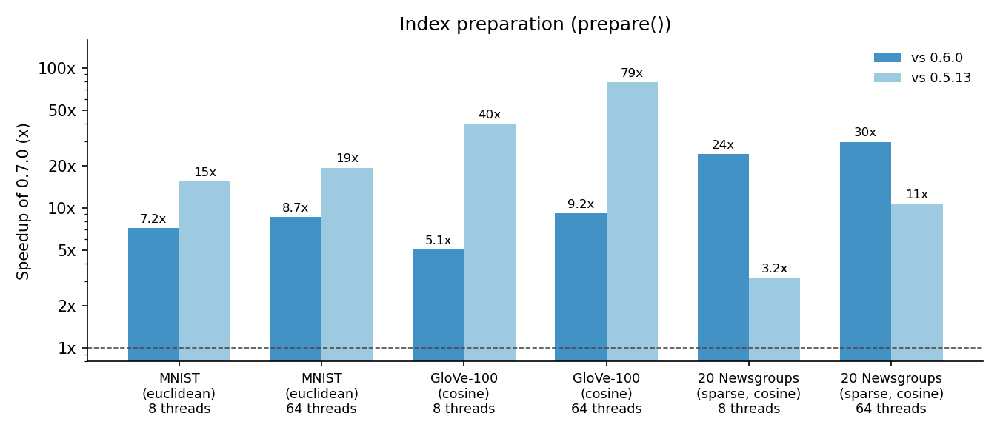
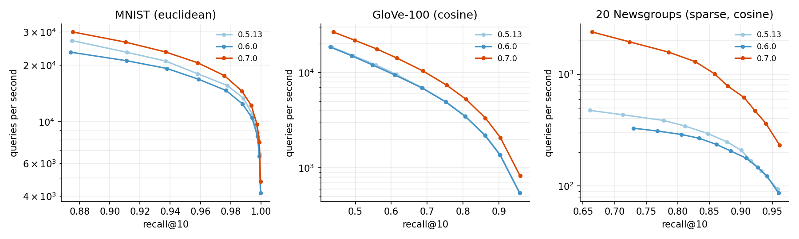
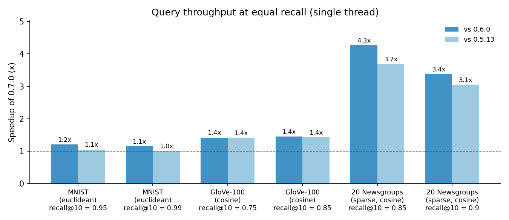

PyNNDescent 0.7 Performance Improvements
========================================

How much faster is PyNNDescent 0.7 than earlier versions? Which parts of using
PyNNDescent have gotten faster, and why? To answer these kinds of questions
we'll compare PyNNDescent 0.7.0 with the two previous releases, 0.6.0 and
0.5.13, on each of the three stages of working with an index: building the
approximate k-nearest neighbor graph (which happens when you create an
``NNDescent`` object), preparing the index for searching (``prepare()``), and
actually querying the index (``query()``). For each stage we'll look at what
changed in 0.7, and then at how much difference those changes make in
practice.

As with any benchmarks, these results reflect a specific choice of datasets
and of benchmarking hardware. Different data and different hardware will
likely result in somewhat different numbers, and we'll see that the size of
the improvements does vary quite a bit from dataset to dataset. None the less
the overall picture is clear: 0.7 is faster across the board, often by a large
margin.

The benchmarks
--------------

We'll use three datasets that differ in size, dimensionality, sparsity and
distance metric, since all of these can affect performance in different ways.

The first is the MNIST dataset. MNIST consists of grayscale images of
handwritten digits (from 0 to 9). Each digit image is 28 by 28 pixels, which
is unravelled into a single vector of 784 dimensions. We use the usual split
into 60,000 training samples, which we build the index on, and 10,000 test
samples, which we use as queries. MNIST uses Euclidean distance.

The second is the GloVe-100 dataset of word vectors. The GloVe vectors are
generated from a word-word co-occurrence count matrix built from a vast
collection of text, with the principle that words with similar meanings are
assigned vectors that are similar in angular distance. This version has 100
dimensional vectors for over a million words, giving 1,183,514 training
samples and 10,000 test samples. It uses cosine distance. This is a
moderately low dimensional but large dataset, and it is by far the most
demanding of the three in terms of index construction.

The last dataset is 20 Newsgroups, a collection of 18,846 posts from twenty
different Usenet newsgroups. We turn each post into a TF-IDF vector using
scikit-learn's ``TfidfVectorizer(min_df=2)``, which gives very high
dimensional (75,875 features) but sparse data, and use cosine distance. We
hold out the last 1,000 posts as queries and build the index on the rest. This
gives us a look at how PyNNDescent handles sparse data, which, as we'll see,
is where many of the biggest improvements in 0.7 are to be found.

For MNIST and GloVe-100 we use the train/test splits and ground truth nearest
neighbors provided by `ann-benchmarks <https://github.com/erikbern/ann-benchmarks>`_;
for 20 Newsgroups we computed the true nearest neighbors exactly. All the
benchmarks use the library defaults, with ``n_neighbors=30``. They were run on
a dual-socket Intel Xeon Platinum 8370C machine (two 16 core processors, for 64
hardware threads in total), once using all 64 threads, and once using 8 threads
pinned to 8 physical cores, to get a sense of the performance on both a large
server and a more typical workstation. All three versions of PyNNDescent were
run in the same Python 3.12 environment, with numba 0.62.1 and numpy 2.3.5, so
that the only thing that differs between them is PyNNDescent itself.

Since PyNNDescent compiles much of its code just-in-time with numba, we warm up
each version on a smaller index before timing anything, so the timings reflect
the steady-state cost of the work rather than the cost of compilation.
Construction and preparation times are the median of several runs, and query
throughput is the best of three runs over the full query set (averaged over
the 8 and 64 thread runs). Queries are run as a single batch on a single
thread, which is the library's default.

Index construction
------------------

Building an index happens in two phases. First PyNNDescent builds a forest of
random projection trees: points that end up in the same leaf of a tree are
likely to be near each other, so the leaves give every point a reasonable set
of initial candidate neighbors. Nearest neighbor descent then refines that
initial graph by repeatedly checking whether the neighbors of a point's
neighbors are closer than the neighbors it already has.

In earlier versions the random projection forest was built one tree per
thread. That meant it could only ever make use of as many cores as there were
trees (typically 6 to 12), and each tree was built depth-first by a single
thread. In 0.7 all the trees are built together, one level at a time. At each
level we work out which side of its node's hyperplane every point falls on in a
single parallel pass over the data (comparing each point against several trees'
hyperplanes at once), and then split all the nodes in parallel. Once nodes get
small enough they are finished off depth-first, again in parallel across all
the trees. Since nearest neighbor descent only needs the leaves of the forest,
we no longer keep the hyperplanes at all.

Nearest neighbor descent itself has also been sped up. The bulk of the work is
computing distances between candidate pairs of points, and for squared
Euclidean and dot-product distances we now compare one point against four
candidates at a time, so that the first point only has to be loaded from memory
once. Building the lists of candidates and applying updates to the graph are
now split up by which thread "owns" each point, so threads no longer need to
scan the whole graph, or each other's updates, to find their work. For dense
data with cosine distance we now normalise the data once when the index is
built; cosine distance then reduces to a dot product, and gets to make use of
the same fast distance computations.

Sparse data gets an additional boost. Sparse distance functions used to build
temporary vectors every time they were called, and the sparse random
projection splits allocated memory for every point. On a machine with many
cores the threads spent most of their time waiting on each other for the memory
allocator. None of that allocation happens any more.

Let's see what difference this makes. The chart below shows how many times
faster 0.7.0 builds an index than 0.6.0 and 0.5.13, for each dataset and number
of threads. Taller bars are better, and note that the y axis is on a log scale
so that the very large and more modest speedups can both be seen.

For the dense datasets 0.7.0 builds an index 1.5 to 2.4 times faster than
0.6.0, and 2.7 to 12 times faster than 0.5.13. The improvements are largest
with 64 threads, which is no surprise given how much more of the work can now
be done in parallel. In fact 0.5.13 was *slower* with 64 threads than with 8 on
all three datasets, while 0.7.0 keeps getting faster as more cores are added.
The sparse 20 Newsgroups data shows the biggest gains of all: with 64 threads,
0.7.0 builds the index 11 times faster than 0.6.0 and 87 times faster than
0.5.13. Importantly, none of this comes at the cost of accuracy. The table
below gives the construction times we measured (the median of three runs, or
two for 0.5.13 on GloVe-100), along with the graph recall -- the fraction of
each point's true 30 nearest neighbors that the index found -- which is the
same or slightly better in 0.7.0.

=============  =======  ==========  =========  =========  =============  ============  ============
Dataset        Threads  0.5.13 (s)  0.6.0 (s)  0.7.0 (s)  0.5.13 recall  0.6.0 recall  0.7.0 recall
=============  =======  ==========  =========  =========  =============  ============  ============
MNIST          8        3.99        2.17       1.46       0.997          0.997         0.997
MNIST          64       5.47        1.39       0.58       0.997          0.997         0.997
GloVe-100      8        90.39       46.91      25.70      0.780          0.781         0.786
GloVe-100      64       126.63      24.32      10.17      0.782          0.781         0.786
20 Newsgroups  8        62.73       34.80      11.58      0.951          0.955         0.955
20 Newsgroups  64       225.40      28.89      2.60       0.949          0.954         0.955
=============  =======  ==========  =========  =========  =============  ============  ============

Index preparation
-----------------

Before an index can be searched it needs to be prepared. This happens
automatically the first time you query an index, or you can call ``prepare()``
yourself to control when the cost is paid. Preparation builds two things: a
search tree, which gives each query a good set of points to start its search
from, and a search graph, which is the k-nearest neighbor graph with redundant
edges pruned away ("diversified"), made undirected, and with the number of
neighbors of any one point capped. It also sets up the function that actually
performs the search.

The search tree is "graph-informed": it chooses where to split by drawing
hyperplanes between highly connected "hub" points of the nearest neighbor
graph. It used to be built by a single-threaded recursion; in 0.7 it is built
level by level in parallel, much as the initialisation forest is, and written
directly into the flat format used for searching. We have also made sure that
splits always keep at least 10% of a node's points on each side, which keeps
the tree shallow (and, as we'll see later, also makes queries faster).

Building the search graph used to involve a chain of single-threaded scipy
sparse matrix operations. Diversification now works in place, without
allocating any memory, and making the graph undirected, pruning it, and
reordering it to match the search tree are all done in parallel instead.

Finally, earlier versions compiled a brand new search function for every
index, specialised to that index's data, which typically took a second or two
every time an index was prepared. For dense data with Euclidean, cosine or dot
distance, 0.7 instead uses a search function that is compiled once and cached
on disk, and which is just as fast as the specialised version. If you would
like the old behaviour it is still available via
``prepare(compile_search=True)``.

As before, the chart below shows how many times faster 0.7.0 is than the
earlier versions, with taller bars being better and a log scale on the y axis.

Here the improvements are even larger than for index construction. For the
dense datasets 0.7.0 prepares an index 5 to 9 times faster than 0.6.0, and 15
to 79 times faster than 0.5.13; preparing the GloVe-100 index, which took over
a minute in 0.5.13, now takes one to two seconds. The sparse 20 Newsgroups data is
an interesting case: 0.6.0 was actually considerably slower than 0.5.13 here
(for reasons we'll get to below), and 0.7.0 improves on 0.6.0 by a factor of 24
to 30, and on 0.5.13 by a factor of 3 to 11. The times we measured for
``prepare()`` are given below.

=============  =======  ==========  =========  =========
Dataset        Threads  0.5.13 (s)  0.6.0 (s)  0.7.0 (s)
=============  =======  ==========  =========  =========
MNIST          8        3.24        1.51       0.21
MNIST          64       3.24        1.45       0.17
GloVe-100      8        71.85       9.10       1.80
GloVe-100      64       75.61       8.78       0.96
20 Newsgroups  8        4.11        31.44      1.29
20 Newsgroups  64       11.03       30.40      1.03
=============  =======  ==========  =========  =========

Queries
-------

Some of the query speedups come from the same places as for index
construction: searching the graph now computes distances to four neighbors at
a time, and cosine distance on dense data is now just a dot product. The rest
comes from better search trees. Each query starts its search from the points in
the leaf of the search tree that it lands in. Previously, a node of the tree
that couldn't be split evenly simply became a leaf, no matter how large it was,
and on some data a handful of leaves ended up holding thousands of points, all
of which had to be checked by any query that landed there. In 0.7 such nodes
are split at the median instead, so the leaves stay small.

Comparing query performance is a little more subtle than comparing build
times, because there is a trade-off between search speed and search accuracy.
The ``epsilon`` parameter to ``query()`` controls how hard the search works:
larger values explore more of the graph and find more of the true nearest
neighbors, but take longer. To compare the versions fairly we ran each of them
with a range of ``epsilon`` values, giving a curve of search speed (queries per
second) against search accuracy (recall@10, the fraction of the true 10
nearest neighbors that were found) for each version.

Curves that are further up and/or further to the right are better, as they
provide more speed and/or more accuracy. Note that the y axis (queries per
second) is on a log scale. To summarise these curves we can compare the number
of queries per second each version manages at the same level of accuracy,
which is what the chart below shows for two different recall levels for each
dataset.

The results vary considerably from dataset to dataset. On MNIST the
improvements are modest: 0.7.0 is 1.1 to 1.2 times faster than 0.6.0, but that
mostly makes up for a slowdown in 0.6.0, and 0.7.0 ends up essentially on par
with 0.5.13. On GloVe-100 0.7.0 is about 1.4 times faster than either of the
earlier versions across the range of accuracies. On the sparse 20 Newsgroups
data the difference is much larger, with 0.7.0 answering queries 3 to 4 times
faster than either earlier version at the same accuracy. The numbers of
queries per second we measured are given below.

=============  =========  ==================  =================  =================
Dataset        recall@10  0.5.13 (queries/s)  0.6.0 (queries/s)  0.7.0 (queries/s)
=============  =========  ==================  =================  =================
MNIST          0.95       19,904              17,341             20,935
MNIST          0.99       12,922              11,436             13,108
GloVe-100      0.75       4,974               4,961              7,061
GloVe-100      0.85       2,416               2,387              3,458
20 Newsgroups  0.85       289                 250                1,066
20 Newsgroups  0.9        208                 188                635
=============  =========  ==================  =================  =================

Sparse data
-----------

It is worth saying a little more about sparse data, since that is where 0.7
makes the biggest difference. Some of that is simply the end of memory
allocation in the sparse distance functions and random projection splits:
with many threads 0.5.13 spent so much time waiting on the memory allocator
that it took over three times longer to build the 20 Newsgroups index with 64
threads than with 8, while 0.7.0 is more than four times faster with 64 threads
than with 8.

The slow index preparation for sparse data in 0.6.0 has a different cause. For
sparse data the 0.6.0 search tree chose its splits to cut as few edges of the
nearest neighbor graph as possible, with no regard for how evenly the points
were divided. That produced extremely lopsided trees: on 20 Newsgroups the tree
went as deep as the 200 level limit would allow. The balanced splits used in
0.7 keep the tree shallow, which makes it both much quicker to build and a much
better starting point for queries. Sparse search trees also no longer pad every
hyperplane out to the size of the dataset, which used to make sparse indexes
far larger than they needed to be.

This concludes our look at the performance of PyNNDescent 0.7. The size of the
improvements depends on the data and on the hardware, but across the datasets
we have looked at here 0.7 builds indexes faster, prepares them much faster,
and answers queries at least as fast as, and often considerably faster than,
earlier versions -- all at the same or better accuracy. If you find cases where
0.7 is slower than an earlier version, please
`open an issue <https://github.com/lmcinnes/pynndescent/issues/new>`_ and let us
know.
